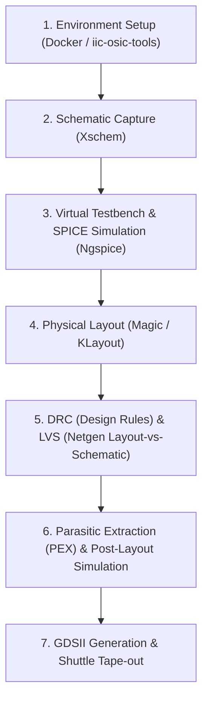
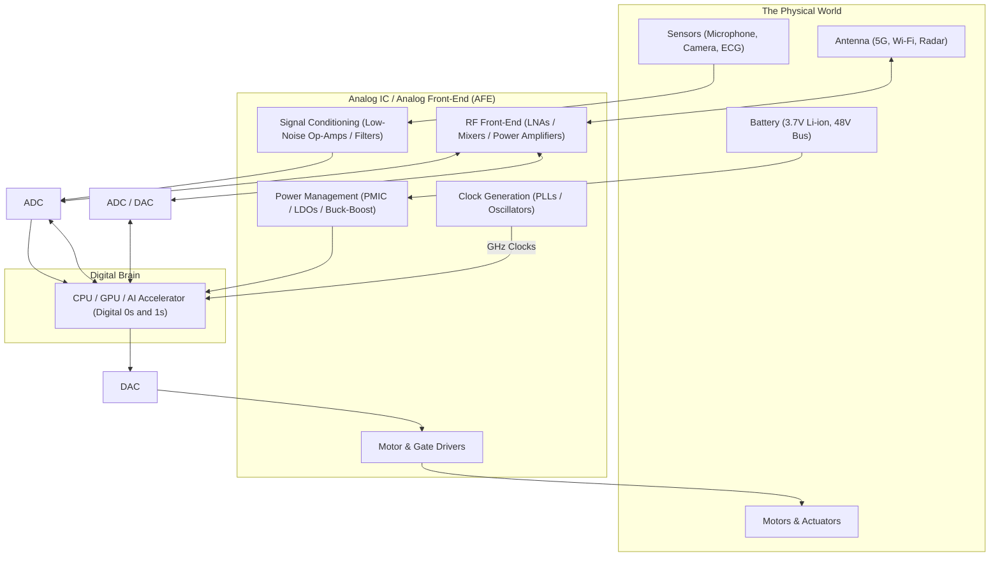
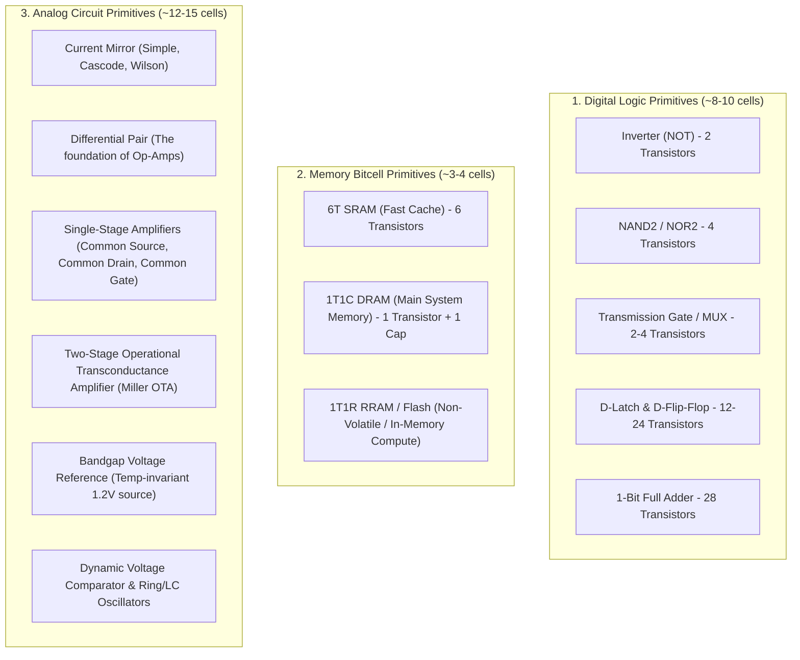

# Analog IC Design with Open-Source Tools

A comprehensive, industry-aligned guide to designing, simulating, laying out, and verifying analog integrated circuits using the modern open-source silicon toolchain.

---

## 1. Overview: The Open-Source Analog Revolution

Traditionally, analog integrated circuit (IC) design was locked behind expensive commercial Electronic Design Automation (EDA) licenses (Cadence, Synopsys, Mentor) costing hundreds of thousands of dollars per seat. 

With the advent of open-source Process Design Kits (PDKs)—such as **Google/SkyWater SKY130** (130nm CMOS) and **IHP SG13G2** (130nm BiCMOS)—it is now possible to design, verify, and fabricate real custom silicon completely using free, open-source software.

---

## 2. The 6-Step End-to-End Design Flow



### Step 1: Environment Setup
Instead of installing dozens of individual dependencies, use the community-maintained, pre-configured container **`IIC-OSIC-TOOLS`** (maintained by Prof. Harald Pretl, JKU Linz):
```bash
# Run the complete open-source EDA suite in a browser/X11 container
docker run -d -p 8080:8080 hpretl/iic-osic-tools
```
Navigate to `http://localhost:8080` to access a Linux desktop with all tools and PDKs pre-installed.

### Step 2: Schematic Capture (`Xschem`)
* **Tool:** `Xschem` (developed by Stefan Schippers).
* **Action:** Draw your circuit topology (e.g., operational transconductance amplifier, current mirror, bandgap reference) using transistor, resistor, and capacitor symbols bound directly to the target PDK (e.g., `sky130_fd_pr`).
* **Sizing Methodology:** Size transistor geometries ($W/L$) using the **$g_m/I_D$ methodology** via lookup tables (LUTs) rather than inaccurate long-channel square-law equations.

### Step 3: Building Virtual Testbenches (`Ngspice`)
* **Concept:** A testbench is **100% virtual software simulation**. It wraps around your circuit (Device Under Test / DUT) to provide stimuli and measure performance before physical manufacturing.
* **Core Testbenches Required:**
  1. **DC Operating Point (`.op`):** Checks transistor bias points to ensure all devices remain in saturation ($V_{DS} > V_{DS,sat}$).
  2. **AC Analysis (`.ac`):** Sweeps frequency to determine open-loop gain, unity-gain frequency ($f_u$), and phase margin ($\ge 60^\circ$ for closed-loop stability).
  3. **Transient Analysis (`.tran`):** Injects step signals to verify slew rate, ringing, and settling time.
  4. **Noise Analysis (`.noise`):** Evaluates thermal and $1/f$ flicker noise.
  5. **PVT & Monte Carlo Analysis:** Simulates performance across Process corners (Fast-Fast, Slow-Slow, Typical), Temperatures ($-40^\circ\text{C}$ to $125^\circ\text{C}$), Supply Voltages ($V_{DD} \pm 10\%$), and random device mismatches.

### Step 4: Physical Mask Layout (`Magic` / `KLayout`)
* **Tools:** `Magic` (Tim Edwards) or `KLayout`.
* **Action:** Draw the actual physical masks: diffusion, polysilicon gates, metal routing layers (e.g., `met1` through `met5`), and via contacts.
* **Analog Matching Rules:**
  * **Common-Centroid / Interdigitation:** Distribute matched transistor pairs (e.g., differential inputs, current mirrors) symmetrically to cancel out spatial oxide thickness and thermal gradients across the die.
  * **Dummy Transistors:** Add non-functional dummy gates at array edges to prevent etching non-uniformities.
  * **Guard Rings:** Surround sensitive analog circuits with substrate tap rings to isolate them from substrate noise caused by digital switching.

### Step 5: Physical Verification (DRC & LVS)
* **DRC (Design Rule Checking - `Magic` / `KLayout`):** Verifies that geometric fabrication limits (minimum metal spacing, minimum enclosure, gate length) are respected.
* **LVS (Layout Versus Schematic - `Netgen`):** Extracts the electrical netlist from the physical layout polygons and matches it against the original schematic netlist to prove that the layout is wired correctly with no short circuits or disconnected pins.

### Step 6: Parasitic Extraction (PEX) & Post-Layout Resimulation
* **Extraction:** Extract parasitic resistances ($R$) and capacitances ($C$) from the physical routing wires.
* **Back-Annotation:** Re-run your original SPICE testbench in `Ngspice` with the extracted parasitic netlist (`.pex.spice`). 
* **Iteration:** If parasitic capacitance lowers your phase margin or slows down your amplifier, return to the layout, compact the routing, and re-verify until all specifications pass across corners.

### Step 7: GDSII Export & Tape-out
* Export the final physical layout as a **GDSII** stream file.
* Package the design into a harness (such as the **Caravel** chip harness by Efabless) and submit for fabrication via Multi-Project Wafer (MPW) shuttle runs.

---

## 3. The Open-Source EDA Toolchain Stack

| Design Phase | Proprietary Commercial Tool | Open-Source Equivalent |
| :--- | :--- | :--- |
| **Schematic Entry** | Cadence Virtuoso Schematic | **Xschem** |
| **SPICE Simulation** | Synopsys HSPICE / Cadence Spectre | **Ngspice** / **Xyce** (Sandia Labs) |
| **Waveform Viewer** | Cadence SimVision / Wavescan | **GAW** / Python (`matplotlib`, `rawread`) |
| **Physical Layout** | Cadence Virtuoso Layout | **Magic** / **KLayout** |
| **DRC (Design Rules)** | Siemens Calibre DRC | **Magic** / **KLayout DRC** |
| **LVS (Netlist Verification)** | Siemens Calibre LVS | **Netgen** |
| **PDK Technology** | TSMC / GF Commercial NDA PDKs | **SkyWater SKY130** / **IHP SG13G2** |
| **Integrated Suite** | Custom Server Install | **`iic-jku/IIC-OSIC-TOOLS`** (Docker) |

---

## 4. Curated Video Tutorials & Learning Resources

### A. Foundational Video Walkthroughs

1. **Stefan Schippers (Creator of Xschem) – Efabless Webinar:**
   * **Title:** *Webinar - Analog schematic capture & simulation with Stefan Schippers*
   * **URL:** [https://www.youtube.com/watch?v=bYbkz8FXnsQ](https://www.youtube.com/watch?v=bYbkz8FXnsQ)
   * **Content:** Complete walkthrough of Xschem, placing PDK components, wiring testbenches, setting up Ngspice simulations, and back-annotating extracted netlists.

2. **Prof. Carsten Wulff (NTNU / Nordic Semiconductor) – Full University Lecture Series:**
   * **YouTube Channel:** [Carsten Wulff (`@CarstenWulff`)](https://www.youtube.com/@CarstenWulff)
   * **Playlists:** *AIC (Advanced Integrated Circuits) 2024 / 2025*
   * **Companion Site:** [analogicus.com](https://analogicus.com)
   * **Content:** Full-semester university course demonstrating real-world analog circuit design (current mirrors, bandgaps, op-amps, ADCs) using Xschem, Ngspice, and custom Python automation.

3. **Matt Venn (Zero to ASIC Course / Tiny Tapeout):**
   * **YouTube Channel:** [Zero To ASIC Course](https://www.youtube.com/@ZeroToASICCourse)
   * **Key Talks:**
     * *"My open source analog microelectronics journey"*
     * *"Mixed Signal ASICs with Open Source tools"*
   * **Content:** An approachable, non-intimidating guide showing how independent engineers and developers can tape out custom silicon using open PDKs.

---

### B. Premier Academic Repositories & Textbooks

1. **Prof. Harald Pretl (JKU Linz – Head of Department for Integrated Circuits):**
   * **GitHub:** [iic-jku/analog-circuit-design](https://github.com/iic-jku/analog-circuit-design)
   * **Docker Suite:** [iic-jku/IIC-OSIC-TOOLS](https://github.com/iic-jku/IIC-OSIC-TOOLS)
   * **Content:** Complete slide decks, Xschem testbenches, and Jupyter notebooks for systematic analog design using open PDKs.

2. **Prof. Boris Murmann (Stanford / University of Hawaii):**
   * **MOS Stages Book:** [bmurmann/Book-on-MOS-stages](https://github.com/bmurmann/Book-on-MOS-stages)
   * **$g_m/I_D$ Sizing Repository:** [bmurmann/Book-on-gm-ID-design](https://github.com/bmurmann/Book-on-gm-ID-design)
   * **IEEE SSCS Open-Source Ecosystem:** [sscs-ose.github.io](https://sscs-ose.github.io/)

---

## 5. Key Theoretical Takeaways & FAQ

### Q1: Is a testbench physical?
**No.** In pre-silicon design, a testbench is entirely virtual (software code in SPICE or Verilog). It injects mathematical signals into your circuit and calculates simulated responses. It is never manufactured onto the physical wafer. *(Only post-silicon testing in a physical lab with oscilloscopes and probes is physical).*

### Q2: How does SPICE relate to Analog In-Memory Computing (e.g., AX100)?
SPICE software uses **Modified Nodal Analysis (MNA)** to solve $G \cdot V = I$ via digital $O(N^3)$ matrix operations. Analog matrix chips like the **AX100** literally turn this equation into physical silicon: you program the conductances ($G$) into resistor/RRAM crossbars, and the circuit's physical charge redistribution solves the linear equation in **$<100\text{ ns}$** via Ohm's and Kirchhoff's laws.

### Q3: Why is digital chip design easier for AI to automate than analog?
* **Digital** has rigid abstractions (standard cell logic gates, binary noise margins, and fast Static Timing Analysis), allowing algorithms like reinforcement learning to verify billions of iterations quickly.
* **Analog** has no standard gates, operates on continuous multi-objective trade-offs (gain vs. bandwidth vs. noise), suffers from layout-dependent parasitics, and requires hours of non-linear SPICE simulation per evaluation, creating a severe simulation bottleneck for AI training.


### Example applications



## 6. The "Periodic Table" of Microelectronics (Canonical Building Blocks)

Microelectronics is deeply modular. Over **95% of the functional area** of modern microprocessors and mixed-signal SoCs is constructed by instantiating and repeating roughly **25 to 30 canonical circuit primitives**:



---

## 7. Open Repositories of Ready-to-Simulate SPICE Building Blocks

You can download, inspect, and simulate every single canonical building block using these open-source repositories:

### 1. Digital Standard Cell Library: `sky130_fd_sc_hd`
* **Repository:** [`google/skywater-pdk-libs-sky130_fd_sc_hd`](https://github.com/google/skywater-pdk-libs-sky130_fd_sc_hd)
* **What's inside:** Transistor-level SPICE netlists (`.spice`), layouts (`.gds`), and behavioral timing models for all digital primitives (Inverters, NAND, NOR, Flip-Flops, Adders).

### 2. Analog Circuit Catalog: `iic-jku/analog-circuit-design`
* **Repository:** [`iic-jku/analog-circuit-design`](https://github.com/iic-jku/analog-circuit-design) (Prof. Harald Pretl, JKU Linz)
* **What's inside:** Categorized Xschem schematics and Ngspice testbenches for current mirrors, differential pairs, amplifiers, bandgaps, and comparators.

### 3. Memory Compilers: `OpenRAM`
* **Repository:** [`VLSIDA/OpenRAM`](https://github.com/VLSIDA/OpenRAM) (UC Santa Cruz)
* **What's inside:** Complete SPICE models for 6T SRAM memory bitcells, sense amplifiers, and row decoders.

### 4. Interactive Browser Simulation: Paul Falstad's Simulator
* **Website:** [falstad.com/circuit](https://www.falstad.com/circuit/)
* **What's inside:** Zero-install, interactive visual simulator with animated electron flow for CMOS inverters, flip-flops, 6T SRAM cells, current mirrors, and op-amps.

---

## 8. Canonical vs. Non-Canonical Circuits (The Frontiers of Chip Design)

### 1. What Does "Canonical" Mean, and Why Only 25 to 30 Blocks?
A **canonical circuit** is an established, mathematically proven archetype that has been standardized and refined over the past 50+ years. 

Over **95% of any commercial chip's functional silicon area**—from an Apple M-series SoC to an automotive microcontroller—is assembled simply by repeating and tiling these **~25 to 30 canonical primitives**:

* **Why the industry sticks strictly to canonical blocks:**
  1. **Predictability:** Their noise margins, phase stability, and corner behaviors across temperature ($-40^\circ\text{C}$ to $+125^\circ\text{C}$) and manufacturing variations are completely understood.
  2. **EDA Automation:** Commercial logic synthesizers and place-and-route engines (Cadence Innovus, Synopsys Fusion Compiler, OpenROAD) are built around pre-characterized standard-cell libraries (`.lib`) of these exact topologies.
  3. **High Foundry Yield:** Leading fabs (TSMC, GlobalFoundries, SCL) tune their optical lithography and etching rules to guarantee near-99% yield for these specific gate layouts.

---

### 2. What are "Non-Canonical" Circuits?
A **non-canonical circuit** is an unconventional, "rule-breaking" topology engineered when standard textbook circuits **fail to satisfy extreme physical constraints** (such as sub-half-volt operation, sub-microwatt energy budgets, or direct physical analog computation).

Here are the primary classes of non-canonical circuits and the engineering tricks behind them:

#### A. Bulk-Driven (Body-Driven) MOSFETs — *Beating the Threshold Voltage Barrier*
* **The Problem:** In standard circuits, input signals are fed into the transistor's **Gate**. However, the gate requires a threshold voltage ($V_{th} \approx 0.4\text{V} - 0.7\text{V}$) just to form an inversion channel. If an energy-harvesting battery supply drops to $0.5\text{V}$, canonical amplifiers cannot turn on.
* **The Non-Canonical Trick:** The gate is tied to a fixed DC supply, and the **input signal is injected directly into the Body/Substrate terminal (the back-gate)**.
* **Result:** It modulates the channel depletion width directly via the bulk-transconductance ($g_{mb}$), eliminating the gate $V_{th}$ headroom requirement and allowing operational amplifiers to function at voltages as low as **$0.4\text{ V}$ to $0.6\text{ V}$**.

#### B. Sub-Threshold / Weak-Inversion Logic — *Running on Leakage Currents*
* **The Problem:** Canonical digital circuits switch transistors fully "ON" and "OFF". Charging and discharging millions of gate capacitances burns milliwatts to watts of dynamic power ($P = C \cdot V^2 \cdot f$).
* **The Non-Canonical Trick:** The circuit operates at a supply voltage below the threshold voltage ($V_{GS} < V_{th}$). Transistors never fully turn on; they compute entirely using **exponential diffusion leakage currents**.
* **Result:** Power consumption drops from milliwatts down to **nano-watts ($10^{-9}\text{ W}$)**. This non-canonical approach powers cardiac pacemakers, cochlear implants, and ambient-RF-powered IoT sensor nodes.

#### C. Adiabatic (Energy-Recovery) Logic — *Recycling Electrical Charge*
* **The Problem:** Every time a canonical CMOS gate switches, it dissipates stored capacitive energy to Ground as heat ($E = \frac{1}{2} C V^2$).
* **The Non-Canonical Trick:** Instead of a constant DC power supply, adiabatic circuits use oscillating **AC power-clock waveforms** with inductive tanks to **recycle electrical charge back into the supply** rather than dumping it to ground.
* **Result:** Achieves extreme energy efficiency and suppresses side-channel power-analysis leakage in secure cryptographic hardware.

#### D. Analog Neuromorphic Crossbars (e.g., AX100 Matrix Accelerators)
* **The Problem:** Canonical von Neumann digital processors waste up to 80% of their total energy shuffling digital matrix data back and forth between memory caches and ALU registers.
* **The Non-Canonical Trick:** Replaces digital logic with physical crossbar arrays of non-volatile analog memristors (RRAM). 
* **Result:** Solves linear matrix systems ($Ax = b$) directly via **Ohm's Law ($I = V \cdot G$) and Kirchhoff's Current Law ($\sum I = 0$) in under 100 nanoseconds**, treating the natural physical settling of the circuit as the calculation itself.

#### E. Chaotic & Stochastic Quantum Noise Generators
* **The Problem:** Pseudo-random digital algorithms are deterministic and vulnerable to cryptanalysis.
* **The Non-Canonical Trick:** Operates reverse-biased Zener diodes in avalanche breakdown or captures quantum tunneling noise across thin oxides to drive a chaotic non-linear attractor circuit.
* **Result:** Generates true, non-deterministic random bitstreams for military-grade hardware encryption.

---

### 3. Canonical vs. Non-Canonical Comparison Matrix

| Attribute | Canonical Circuits | Non-Canonical Circuits |
| :--- | :--- | :--- |
| **Typical Topologies** | Inverters, NAND/NOR, D-Flip-Flop, Two-Stage Miller OTA, Bandgap, 6T SRAM | Bulk-driven amplifiers, Sub-threshold logic, Memristive crossbars, Adiabatic logic |
| **Domain Representation** | **>95% of all silicon** (CPUs, GPUs, standard SoCs, mixed-signal chips) | **<5% specialized niche** (biomedical implants, analog AI accelerators, crypto ASICs) |
| **EDA Toolchain Support** | **100% Automated:** Automated synthesis, STA timing, auto-routing, and DRC/LVS | **Manual / Hand-Crafted:** Standard synthesizers cannot model these physics; requires custom SPICE design |
| **Design Risk & Yield** | Low risk; predictable across all PVT corners; high foundry yield | High risk; sensitive to temperature and process variations; requires defensive guarding |
| **Primary Strength** | Speed, scalability, standardized modular design | Extreme power savings, low-voltage headroom survival, or physical computing shortcuts |


 ──────
  ### 1. The Ultimate Analog Transistor Kit: "The Discrete 741 Op-Amp Kit"

  • Created by: Evil Mad Scientist Laboratories (designed by hardware reverse-engineer Eric Schlaepfer).
  • What it is: A working, giant-scale circuit board that recreates the exact internal transistor-level schematic of the legendary LM741
  operational amplifier using individual through-hole transistors and resistors.
  • What you learn:
      • You solder the physical discrete transistors for the current mirror, the differential input pair, the voltage level-shifter, and
      the output push-pull stage.
      • It includes test terminal pins so you can clip an oscilloscope probe to any internal node and watch how the current mirror
      copies current, or how the differential pair splits input voltages.
  • Companion Kit: They also make "The Discrete 555 Timer Kit", which breaks down the internal flip-flop, comparator, and discharge
  transistors of a 555 timer.
  • Website: evilmadscientist.com https://www.evilmadscientist.com/
  ──────
  ### 2. The University Gold Standard: Analog Devices ADALP2000 (Analog Parts Kit)

  • Created by: Analog Devices (used in undergraduate electrical engineering courses at MIT, Stanford, and IITs).
  • What it is: A comprehensive parts kit containing discrete NMOS and PMOS transistors, matched BJT transistor pairs (matched for
  building accurate current mirrors), diodes, precision resistors, capacitors, sensors, and IC building blocks.
  • Free Accompanying Curriculum: Analog Devices provides a 100% free online laboratory manual called the ADALM2000 Active Learning Labs.
  • Key Experiments You Build on a Breadboard:
      • Building a discrete differential pair from scratch.
      • Building a Wilson current mirror and measuring output impedance.
      • Building a common-source amplifier and measuring bandwidth.
  • Website: Search for Analog Devices ADALP2000 on DigiKey, Mouser, or element14.
  ──────
  ### 3. The $10 University Secret Weapon: The "CD4007" CMOS Transistor Array

  If you don't want to buy an expensive kit and just want to experiment on a cheap breadboard with real CMOS logic:

  • The Component: Buy a few CD4007 (or CD4007UBE) chips (costs ~$1.00 / ₹80 each).
  • What it contains: Inside this single 14-pin dual-inline (DIP) chip are 3 individual uncommitted PMOS transistors and 3 individual
  uncommitted NMOS transistors.
  • What you can build with it on a breadboard:
      • A real CMOS Inverter (1 PMOS + 1 NMOS).
      • A real NAND2 or NOR2 gate.
      • A real CMOS Transmission Gate (analog switch).
      • A real Source Follower analog buffer.
      • A real 6T SRAM memory bitcell.
  • Why professors love it: Unlike discrete MOSFETs (like the 2N7000), the transistors inside a CD4007 are on the same silicon die, 
  meaning they have closely matched threshold voltages (Vₜₕ) and behave exactly like real on-chip integrated circuits.
  ──────
  ### 4. The Ultimate Digital Computer Kit: Ben Eater's 8-Bit Computer

  • Created by: Ben Eater (https://eater.net).
  • What it is: The most famous educational hardware project in the world. You build a fully programmable, Turing-complete 8-bit CPU  
  from scratch on breadboards using basic logic gates, flip-flops, registers, RAM, and a clock module.
  • What you learn:
      • Clock Module: Building a square-wave clock with 555 timers and logic gates.
      • Registers & RAM: Wiring discrete latches and flip-flops into memory banks.
      • ALU (Arithmetic Logic Unit): Wiring full adders and XOR gates to do binary addition and subtraction.
  • YouTube Series: Even if you don't buy the physical kit, Ben Eater's YouTube series is completely free and is widely considered the
  single best visual tutorial on digital logic and computer architecture on the internet.
  ──────
