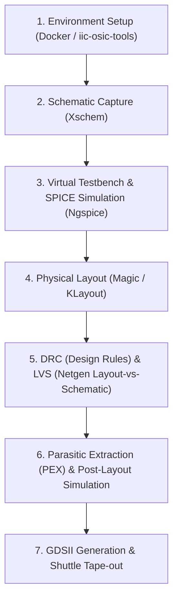
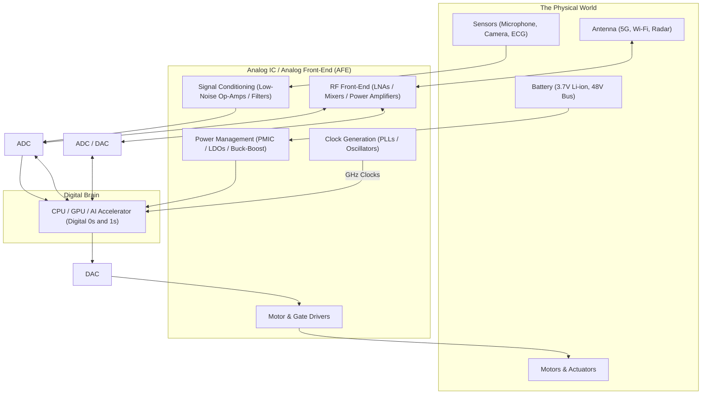

# Analog IC Design with Open-Source Tools

A comprehensive, industry-aligned guide to designing, simulating, laying out, and verifying analog integrated circuits using the modern open-source silicon toolchain.

---

## 1. Overview: The Open-Source Analog Revolution

Traditionally, analog integrated circuit (IC) design was locked behind expensive commercial Electronic Design Automation (EDA) licenses (Cadence, Synopsys, Mentor) costing hundreds of thousands of dollars per seat. 

With the advent of open-source Process Design Kits (PDKs)—such as **Google/SkyWater SKY130** (130nm CMOS) and **IHP SG13G2** (130nm BiCMOS)—it is now possible to design, verify, and fabricate real custom silicon completely using free, open-source software.

---

## 2. The 6-Step End-to-End Design Flow



### Step 1: Environment Setup
Instead of installing dozens of individual dependencies, use the community-maintained, pre-configured container **`IIC-OSIC-TOOLS`** (maintained by Prof. Harald Pretl, JKU Linz):
```bash
# Run the complete open-source EDA suite in a browser/X11 container
docker run -d -p 8080:8080 hpretl/iic-osic-tools
```
Navigate to `http://localhost:8080` to access a Linux desktop with all tools and PDKs pre-installed.

### Step 2: Schematic Capture (`Xschem`)
* **Tool:** `Xschem` (developed by Stefan Schippers).
* **Action:** Draw your circuit topology (e.g., operational transconductance amplifier, current mirror, bandgap reference) using transistor, resistor, and capacitor symbols bound directly to the target PDK (e.g., `sky130_fd_pr`).
* **Sizing Methodology:** Size transistor geometries ($W/L$) using the **$g_m/I_D$ methodology** via lookup tables (LUTs) rather than inaccurate long-channel square-law equations.

### Step 3: Building Virtual Testbenches (`Ngspice`)
* **Concept:** A testbench is **100% virtual software simulation**. It wraps around your circuit (Device Under Test / DUT) to provide stimuli and measure performance before physical manufacturing.
* **Core Testbenches Required:**
  1. **DC Operating Point (`.op`):** Checks transistor bias points to ensure all devices remain in saturation ($V_{DS} > V_{DS,sat}$).
  2. **AC Analysis (`.ac`):** Sweeps frequency to determine open-loop gain, unity-gain frequency ($f_u$), and phase margin ($\ge 60^\circ$ for closed-loop stability).
  3. **Transient Analysis (`.tran`):** Injects step signals to verify slew rate, ringing, and settling time.
  4. **Noise Analysis (`.noise`):** Evaluates thermal and $1/f$ flicker noise.
  5. **PVT & Monte Carlo Analysis:** Simulates performance across Process corners (Fast-Fast, Slow-Slow, Typical), Temperatures ($-40^\circ\text{C}$ to $125^\circ\text{C}$), Supply Voltages ($V_{DD} \pm 10\%$), and random device mismatches.

### Step 4: Physical Mask Layout (`Magic` / `KLayout`)
* **Tools:** `Magic` (Tim Edwards) or `KLayout`.
* **Action:** Draw the actual physical masks: diffusion, polysilicon gates, metal routing layers (e.g., `met1` through `met5`), and via contacts.
* **Analog Matching Rules:**
  * **Common-Centroid / Interdigitation:** Distribute matched transistor pairs (e.g., differential inputs, current mirrors) symmetrically to cancel out spatial oxide thickness and thermal gradients across the die.
  * **Dummy Transistors:** Add non-functional dummy gates at array edges to prevent etching non-uniformities.
  * **Guard Rings:** Surround sensitive analog circuits with substrate tap rings to isolate them from substrate noise caused by digital switching.

### Step 5: Physical Verification (DRC & LVS)
* **DRC (Design Rule Checking - `Magic` / `KLayout`):** Verifies that geometric fabrication limits (minimum metal spacing, minimum enclosure, gate length) are respected.
* **LVS (Layout Versus Schematic - `Netgen`):** Extracts the electrical netlist from the physical layout polygons and matches it against the original schematic netlist to prove that the layout is wired correctly with no short circuits or disconnected pins.

### Step 6: Parasitic Extraction (PEX) & Post-Layout Resimulation
* **Extraction:** Extract parasitic resistances ($R$) and capacitances ($C$) from the physical routing wires.
* **Back-Annotation:** Re-run your original SPICE testbench in `Ngspice` with the extracted parasitic netlist (`.pex.spice`). 
* **Iteration:** If parasitic capacitance lowers your phase margin or slows down your amplifier, return to the layout, compact the routing, and re-verify until all specifications pass across corners.

### Step 7: GDSII Export & Tape-out
* Export the final physical layout as a **GDSII** stream file.
* Package the design into a harness (such as the **Caravel** chip harness by Efabless) and submit for fabrication via Multi-Project Wafer (MPW) shuttle runs.

---

## 3. The Open-Source EDA Toolchain Stack

| Design Phase | Proprietary Commercial Tool | Open-Source Equivalent |
| :--- | :--- | :--- |
| **Schematic Entry** | Cadence Virtuoso Schematic | **Xschem** |
| **SPICE Simulation** | Synopsys HSPICE / Cadence Spectre | **Ngspice** / **Xyce** (Sandia Labs) |
| **Waveform Viewer** | Cadence SimVision / Wavescan | **GAW** / Python (`matplotlib`, `rawread`) |
| **Physical Layout** | Cadence Virtuoso Layout | **Magic** / **KLayout** |
| **DRC (Design Rules)** | Siemens Calibre DRC | **Magic** / **KLayout DRC** |
| **LVS (Netlist Verification)** | Siemens Calibre LVS | **Netgen** |
| **PDK Technology** | TSMC / GF Commercial NDA PDKs | **SkyWater SKY130** / **IHP SG13G2** |
| **Integrated Suite** | Custom Server Install | **`iic-jku/IIC-OSIC-TOOLS`** (Docker) |

---

## 4. Curated Video Tutorials & Learning Resources

### A. Foundational Video Walkthroughs

1. **Stefan Schippers (Creator of Xschem) – Efabless Webinar:**
   * **Title:** *Webinar - Analog schematic capture & simulation with Stefan Schippers*
   * **URL:** [https://www.youtube.com/watch?v=bYbkz8FXnsQ](https://www.youtube.com/watch?v=bYbkz8FXnsQ)
   * **Content:** Complete walkthrough of Xschem, placing PDK components, wiring testbenches, setting up Ngspice simulations, and back-annotating extracted netlists.

2. **Prof. Carsten Wulff (NTNU / Nordic Semiconductor) – Full University Lecture Series:**
   * **YouTube Channel:** [Carsten Wulff (`@CarstenWulff`)](https://www.youtube.com/@CarstenWulff)
   * **Playlists:** *AIC (Advanced Integrated Circuits) 2024 / 2025*
   * **Companion Site:** [analogicus.com](https://analogicus.com)
   * **Content:** Full-semester university course demonstrating real-world analog circuit design (current mirrors, bandgaps, op-amps, ADCs) using Xschem, Ngspice, and custom Python automation.

3. **Matt Venn (Zero to ASIC Course / Tiny Tapeout):**
   * **YouTube Channel:** [Zero To ASIC Course](https://www.youtube.com/@ZeroToASICCourse)
   * **Key Talks:**
     * *"My open source analog microelectronics journey"*
     * *"Mixed Signal ASICs with Open Source tools"*
   * **Content:** An approachable, non-intimidating guide showing how independent engineers and developers can tape out custom silicon using open PDKs.

---

### B. Premier Academic Repositories & Textbooks

1. **Prof. Harald Pretl (JKU Linz – Head of Department for Integrated Circuits):**
   * **GitHub:** [iic-jku/analog-circuit-design](https://github.com/iic-jku/analog-circuit-design)
   * **Docker Suite:** [iic-jku/IIC-OSIC-TOOLS](https://github.com/iic-jku/IIC-OSIC-TOOLS)
   * **Content:** Complete slide decks, Xschem testbenches, and Jupyter notebooks for systematic analog design using open PDKs.

2. **Prof. Boris Murmann (Stanford / University of Hawaii):**
   * **MOS Stages Book:** [bmurmann/Book-on-MOS-stages](https://github.com/bmurmann/Book-on-MOS-stages)
   * **$g_m/I_D$ Sizing Repository:** [bmurmann/Book-on-gm-ID-design](https://github.com/bmurmann/Book-on-gm-ID-design)
   * **IEEE SSCS Open-Source Ecosystem:** [sscs-ose.github.io](https://sscs-ose.github.io/)

---

## 5. Key Theoretical Takeaways & FAQ

### Q1: Is a testbench physical?
**No.** In pre-silicon design, a testbench is entirely virtual (software code in SPICE or Verilog). It injects mathematical signals into your circuit and calculates simulated responses. It is never manufactured onto the physical wafer. *(Only post-silicon testing in a physical lab with oscilloscopes and probes is physical).*

### Q2: How does SPICE relate to Analog In-Memory Computing (e.g., AX100)?
SPICE software uses **Modified Nodal Analysis (MNA)** to solve $G \cdot V = I$ via digital $O(N^3)$ matrix operations. Analog matrix chips like the **AX100** literally turn this equation into physical silicon: you program the conductances ($G$) into resistor/RRAM crossbars, and the circuit's physical charge redistribution solves the linear equation in **$<100\text{ ns}$** via Ohm's and Kirchhoff's laws.

### Q3: Why is digital chip design easier for AI to automate than analog?
* **Digital** has rigid abstractions (standard cell logic gates, binary noise margins, and fast Static Timing Analysis), allowing algorithms like reinforcement learning to verify billions of iterations quickly.
* **Analog** has no standard gates, operates on continuous multi-objective trade-offs (gain vs. bandwidth vs. noise), suffers from layout-dependent parasitics, and requires hours of non-linear SPICE simulation per evaluation, creating a severe simulation bottleneck for AI training.


### Example applications

